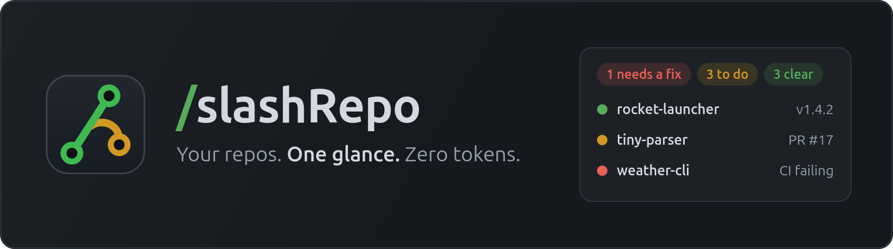
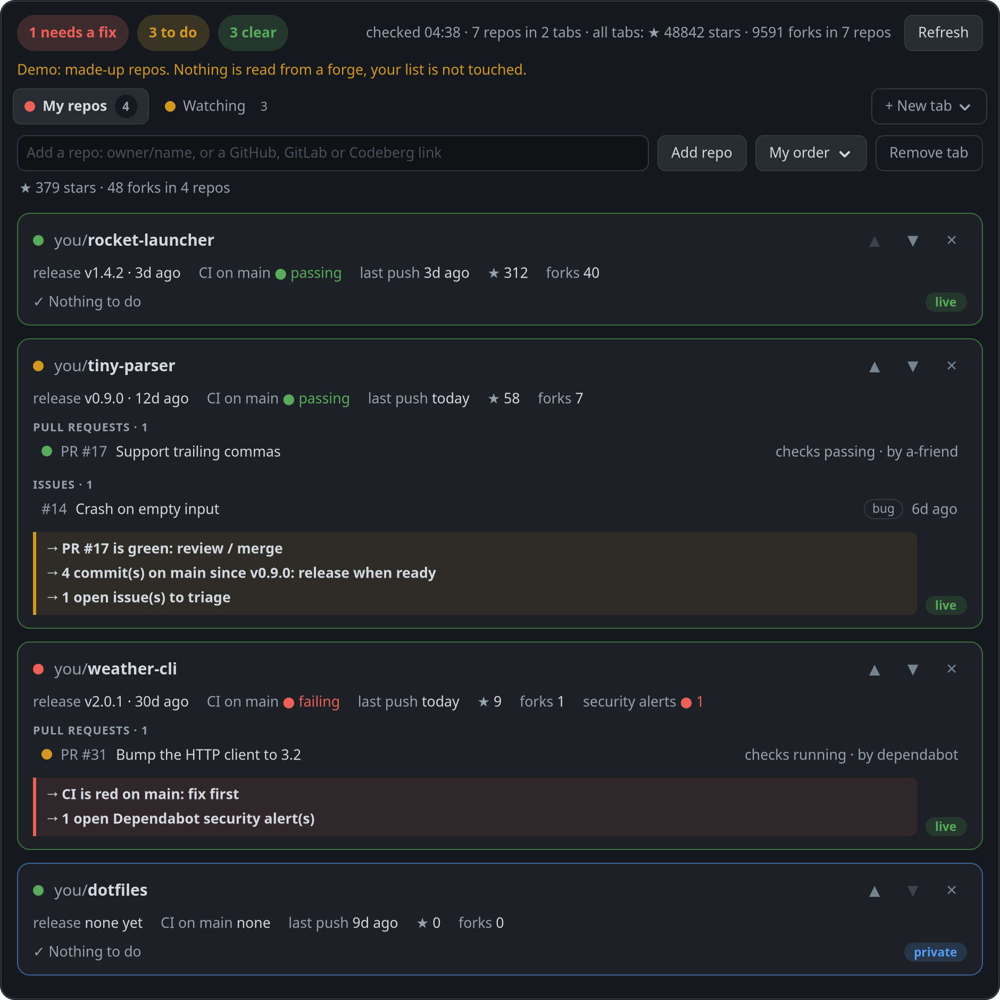
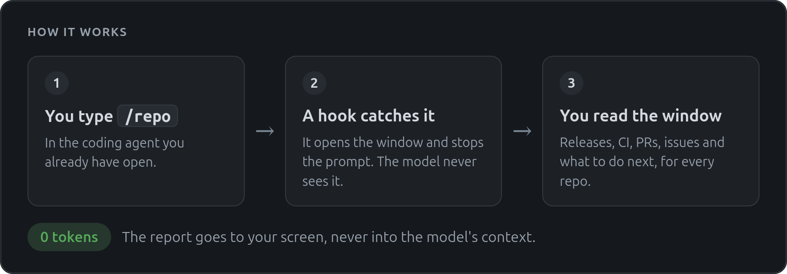
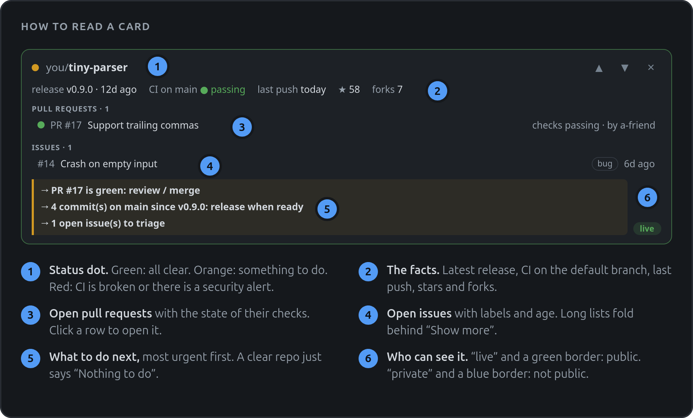
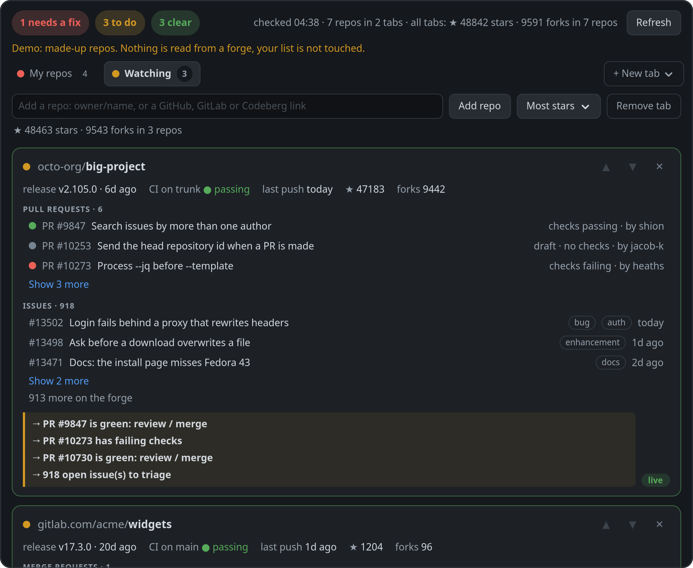
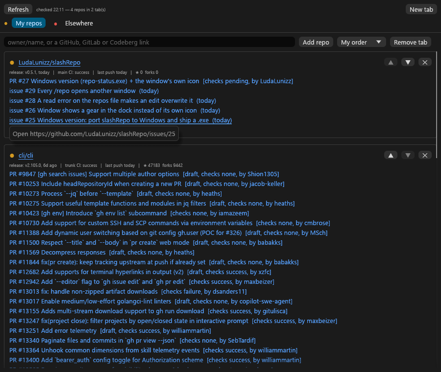

<p align="center">
  
</p>

**Type `/repo` in your coding agent. A window shows where every one of your repos stands.
The model reads none of it, so the report costs no tokens.**

<p align="center">
  
</p>

You already have a coding AI open, and repos to keep an eye on. Asking the AI to check them means it
calls `gh`, reads JSON and writes you a summary: tokens spent on something you could have read yourself.
slashRepo puts it in front of you instead: the latest release, CI, open PRs and issues, security
alerts and a short to-do for every repo, checked again each time you open it.

## Contents

- [How it works](#how-it-works)
- [How to read a card](#how-to-read-a-card)
- [Try it first](#try-it-first)
- [Install](#install)
- [Works with every major coding agent](#works-with-every-major-coding-agent)
- [Tabs](#tabs)
- [On Windows](#on-windows)
- [Keys](#keys)
- Details: [private repos and other hosts](#private-repos-and-other-hosts) ·
  [agents in a sandbox](#agents-in-a-sandbox) · [limits](#limits) ·
  [what install touches](#what-install-touches) · [why it is built this way](#why-it-is-built-this-way) ·
  [the fine print](#the-fine-print)

## How it works

<p align="center">
  
</p>

A hook opens the window the moment you press Enter and stops the prompt before it reaches the model:
no turn, no reply, no tokens.

That is Claude Code. opencode, Gemini CLI, Codex and Antigravity have no way to stop a prompt, so their
`/repo` still costs one short model turn. The repo info itself costs nothing in any of them.

| Without slashRepo | With slashRepo |
|---|---|
| "Check my repos": the AI calls `gh`, reads JSON, writes a summary, you read the summary | `/repo`: a window with everything, right now |
| Tokens spent on every check | 0 tokens, every time |
| One repo at a time, or a wall of text | All repos at a glance, in tabs, colour-coded |
| Stale the moment it is printed | Press Refresh whenever you want |

## How to read a card

<p align="center">
  
</p>

The pills at the top of the window count the dots over all your tabs: how many repos **need a fix**
(red), have something **to do** (orange) or are **clear** (green).

| Dot | Means |
|---|---|
| 🟢 green | Nothing asks for you |
| 🟠 orange | Something to do: a PR to review, commits waiting for a release, issues to triage |
| 🔴 red | Fix first: CI is failing on the default branch, there is a security alert, or the check itself failed |

Every name, pull request and issue opens in your browser with a click.

## Try it first

```sh
repo-status --demo
```

opens the window with the made-up repos from the pictures above. It reads no forge and never touches
your repo list, so you can click around freely.

## Install

**Linux:** GTK 4.12+ and `gh` logged in. That's it.

```sh
git clone https://github.com/LudaLunizz/slashRepo
cd slashRepo && ./install.sh
```

**Windows 10/11 (x86_64):** `gh` logged in. Nothing else: one `.exe`, no runtime to install.

```powershell
git clone https://github.com/LudaLunizz/slashRepo
cd slashRepo; powershell -ExecutionPolicy Bypass -File install.ps1
```

Or skip the clone: download `repo-status-x86_64-windows.exe` from the
[latest release](https://github.com/LudaLunizz/slashRepo/releases/latest), double-click it for the
window, or run `repo-status-x86_64-windows.exe install` once to set up `/repo` and the Start Menu entry.

Has Rust? It builds from source. No Rust? It downloads the prebuilt binary and verifies the checksum.
Then it hooks into every agent it finds.

## Works with every major coding agent

| Agent | Command | Tokens for the report |
|---|---|---|
| **Claude Code** | `/repo` or "repo check" | **0**: the prompt never reaches the model |
| **opencode** | `/repo` | **0** (a few for the one-line reply) |
| **Gemini CLI** | `/repo` | **0** (a few for the one-line reply) |
| **Codex** | `$repo` | **0** (a few for one command) |
| **Antigravity** | `/repo` | **0** (a few for one command) |

One install, all agents. The report itself never reaches the model in any of them. Only Claude Code can
drop the prompt before the model sees it, so only there nothing at all is spent; the others still take one
short turn to run the command. Runs in a sandbox too: see [Agents in a sandbox](#agents-in-a-sandbox).
Which agents have actually been run is under [Limits](#limits).

## Tabs

<p align="center">
  
</p>

Group repos into tabs; each tab shows its worst dot and its repo count. Move repos with the ▲▼ buttons,
or let a tab sort itself by stars or forks. Mix GitHub, GitLab and Codeberg in the same view
([private repos and other hosts](#private-repos-and-other-hosts) need a token). A repo with many PRs or
issues shows the first three; the rest folds behind "Show more".

The window edits a plain text file, and so can you:

```ini
[Mine]
me/fast-api
me/slow-api

[Watching]
sort = stars
gitlab.com/gitlab-org/cli
codeberg.org/forgejo/forgejo
tokio-rs/tokio
```

No file yet? It starts with your 20 newest non-fork repos, and saves once you change something.
The file is `~/.config/slashrepo/repos`, or `$XDG_CONFIG_HOME/slashrepo/repos` when that is set
(Windows: `%APPDATA%\slashRepo\repos`).

## On Windows

One self-contained `.exe` for Windows 10/11, nothing else to install. Same window, same tabs, same
`/repo`, same zero tokens.

<p align="center">
  
</p>

*The real thing: the exe took this picture of itself on a GitHub Windows runner (no GPU needed).*

## Keys

| Key | Does |
|---|---|
| `F5` or `Ctrl+R` | Check every repo again |
| `Ctrl+L` | Go to the "Add a repo" field |
| `Ctrl+PageDown` / `Ctrl+PageUp` | Next / previous tab |
| `Ctrl+W` | Close the window |

## Private repos and other hosts

- **GitHub** goes through your `gh` login, for public repos too, so `gh` must be installed and logged in.
  There is no token variable.
- **GitLab** public projects need nothing. For a private one set `GITLAB_TOKEN` (a read-only token is
  enough). For a self-hosted GitLab also set `GITLAB_HOST=gitlab.example.org` (the host name only) and
  list the project as `gitlab.example.org/group/project`. One host gets the token; the token is never
  sent anywhere else.
- **Codeberg** public repos need nothing. For a private one set `CODEBERG_TOKEN`; it goes to
  codeberg.org only. Self-hosted Forgejo, Gitea and Bitbucket are not supported.

Set the variables in the environment that starts the window (your login session, or the shell that
runs the agent).

## Agents in a sandbox

Some agents run commands in a sandbox that cannot see `repo-status` or open a window. On Linux, give
them a trigger file instead:

```sh
./install.sh --trigger /home/you/.slashrepo-open     # an absolute path; or: repo-status install --trigger FILE
```

That adds a systemd user unit (`slashrepo-trigger.path`) which opens the window whenever the file is
written. Give the sandbox write access to that one file and set `SLASHREPO_TRIGGER=` to its path inside
it. The opencode and Gemini CLI commands then write the file when they cannot reach `repo-status`. The
Codex and Antigravity skill has no such fallback: ask it to run the command outside the sandbox. All the
sandbox gains is the ability to write one file, which opens a read-only window. Windows has no trigger
file (`--trigger` is Linux only).

## Limits

- **The hook** opens the window when a prompt says `repo check` or `check the repos` as whole words, or has
  a line that starts with `/repo`. A prompt that is only that is blocked; a longer one goes through to the
  model with the window opened beside it. If the window cannot be started, nothing is blocked.
- **Lists are capped:** up to 30 open PRs and 30 issues per repo, with an "and N more" line for issues.
- **Tested with:** Claude Code and opencode have been run with `/repo`. Gemini CLI, Codex and Antigravity
  have not: their files were checked against each agent's own docs on 26 Nov 2026
  ([Gemini CLI](https://github.com/google-gemini/gemini-cli/blob/main/docs/cli/custom-commands.md),
  [Codex](https://learn.chatgpt.com/docs/build-skills),
  [Antigravity](https://antigravity.google/docs/skills.md)). None of these docs gives the Windows paths.
  If one of them does not work for you, please open an issue.
- **Gemini CLI asks first:** it shows the shell command in `/repo` and waits for your OK before it runs it,
  unless a [policy](https://github.com/google-gemini/gemini-cli/blob/main/docs/reference/policy-engine.md)
  in `~/.gemini/policies/` allows it. slashRepo does not write one for you.
- **Hosts:** GitHub, GitLab (one authenticated host) and codeberg.org. Dependabot alerts exist on GitHub only.
- **Platforms:** Linux x86_64 and Windows 10/11 x86_64. The prebuilt Linux binary is built on Ubuntu 24.04,
  so it needs glibc 2.39 or newer; older systems build from source (Rust and the GTK 4 dev files).
  macOS: not yet.
- **The checksum** next to a prebuilt binary comes from the same release page. It catches a damaged
  download, not a compromised release.
- **Read-only by behaviour:** it never writes to a forge, but it uses whatever your `gh` login or token
  can do. Use read-only tokens.

## What install touches

On Linux: `~/.local/bin/repo-status`, a desktop file and an icon (`io.github.ludalunizz.SlashRepo.*`
under `~/.local/share`), and for each agent it finds:

| Agent | File |
|---|---|
| Claude Code | `~/.claude/commands/repo.md`, a hook in `~/.claude/settings.json` (copy of the old file: `settings.json.bak-slashrepo`) |
| opencode | `~/.config/opencode/commands/repo.md` (an older `command/repo.md` of ours is taken away) |
| Gemini CLI | `~/.gemini/commands/repo.toml` |
| Codex | `~/.agents/skills/repo/SKILL.md` |
| Antigravity | `~/.gemini/config/skills/repo/SKILL.md` |

With `--trigger`: two units in `~/.config/systemd/user/` and the trigger file. On Windows: the exe in
`%LOCALAPPDATA%\Programs\slashRepo`, a Start Menu entry, and the same agent files under your user folder.
`repo-status uninstall` removes exactly these (your repo list, the trigger file and any file of yours stay).

## Why it is built this way

- **A window, not a TUI or an MCP tool.** A window opens beside the agent and stays out of its
  context. A tool result would put the report back in the model's context, which is the cost this avoids.
- **`gh` for GitHub, plain HTTPS for GitLab and Codeberg.** `gh` already holds your login and speaks GraphQL,
  so one call per repo is enough. The other hosts have no such tool everyone has, so they use their REST APIs
  and an optional token (see above).
- **A text file for the list.** One repo per line, tabs in `[brackets]`: easy to edit, diff and keep in a
  dotfiles repo. The window edits the same file.
- **Read-only on purpose.** It never writes to a forge, so a bug cannot close an issue or merge a PR.
- **A hook, not a model.** The only way to keep a prompt away from the model is a hook that runs first.
  Claude Code has one; the other agents do not, hence the one-line difference above.

## The fine print

- **Linux (GTK 4) and Windows 10/11.** Same window, same file format, same flags. macOS: not yet.
- **Windows notes.** The exe is not code-signed yet, so SmartScreen may ask once ("More info" → "Run
  anyway"); compare it with `SHA256SUMS` from the release. It installs to
  `%LOCALAPPDATA%\Programs\slashRepo`; add that folder to your PATH to type `repo-status` anywhere.
  In PowerShell or cmd, add `| more` to `repo-status --text` (Windows doesn't wait for a windowed program);
  Git Bash needs nothing extra. The sandbox trigger (`--trigger`) is Linux only.
- **Install and uninstall are tidy.** `install` leaves a `/repo` command or skill of your own alone (it only
  replaces files that call `repo-status`), keeps a copy of `settings.json` from before each change, and
  says what it did per agent. `repo-status uninstall` takes it all out again (hook, command files,
  menu entry, program) and keeps your repo list.
- **Read-only.** It looks at your repos and changes nothing on them.
- **MIT licensed.** Fork it, ship it, do what you want.

---

**One keystroke. Every repo. No tokens.** [Install it.](#install)
