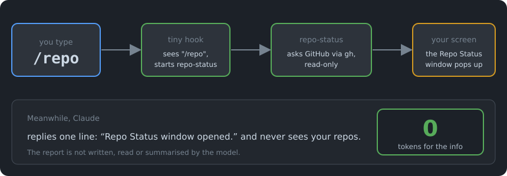

# slashRepo

**Type `/repo`. Your repos show up. The AI spends zero tokens on it.**



You have a pile of GitHub repos. Is CI red somewhere? Did a PR turn green while you were not looking?
Did you forget to cut a release four commits ago? Normally you would ask an AI to go look, and pay tokens
for it to read a wall of JSON and tell you what you could have read yourself.

slashRepo skips the middleman. `/repo` pops open a window that already has the answer:


Per repo you get the latest release, CI on the default branch, open PRs and issues, Dependabot alerts,
commits since the last release, and a short to-do list. A dot tells you the mood at a glance:
🟢 nothing to do, 🟠 something is waiting for you, 🔴 CI is red or there is a security alert.

## About those tokens

The report is made by a small Python script that talks to GitHub through `gh`. A Claude Code hook starts it
the moment you send the prompt. **Claude never reads, writes or summarises the report**, so the repo info
costs **0 tokens**. All Claude does is answer one line: "Repo Status window opened."
(That one line is the only thing the turn costs; the numbers in the window are free.)

It is also read-only. It looks, it never touches.

## Install

Needs `gh` (logged in), `jq`, and `python3` with PyGObject + GTK 4 (Linux).

```sh
git clone https://github.com/LudaLunizz/slashRepo
cd slashRepo && ./install.sh
```

This copies `repo-status` and `repo-status-hook` to `~/.local/bin`, `repo.md` to `~/.claude/commands`,
adds a desktop entry, and adds the hook to `~/.claude/settings.json` (backup: `settings.json.bak-slashrepo`).
Running it again changes nothing.

## Choose the repos

By default: your own non-fork, non-archived repos (`gh repo list`, newest 20). To pick them yourself, put
one `owner/name` per line in `~/.config/slashrepo/repos` (`#` starts a comment). Repos you do not own work too.

## Use

- `/repo`, "repo check" or "check the repos" in Claude Code opens the window.
- `repo-status` opens it from a terminal or the app menu.
- `repo-status --text` prints the same report as plain text, handy over SSH.

## Limits

Linux and GTK 4 only. The hook matches the prompt text, so a prompt that mentions "repo check" in passing
also opens the window. The pictures above use made-up repos.

## Licence

MIT. See [LICENSE](LICENSE).
