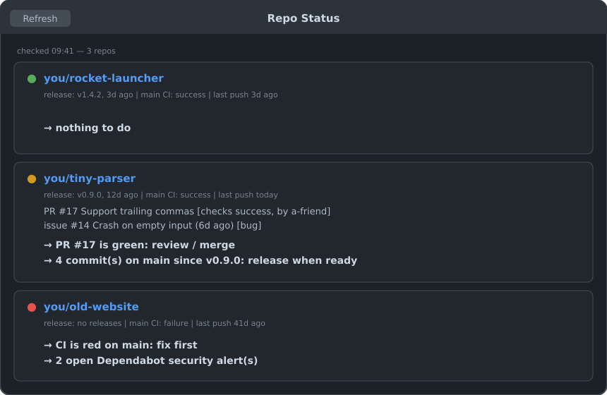

# slashRepo

**Your repos. One glance. Zero tokens.**


You already have a coding AI open. You already have repos to keep an eye on. Right now, checking
them means asking the AI to read API responses and parrot them back — burning tokens on information
you could have read yourself, if only someone put it in front of you.

slashRepo does exactly that. Type `/repo`. A window appears:



Every repo gets a colored dot: 🟢 all clear, 🟠 something needs you, 🔴 CI is broken or there is a
security alert. Latest release, open PRs, issues, Dependabot alerts, CI status, commits since the last
tag, and a short to-do — all in one place, refreshed every time you open it.

**The AI never sees any of it.** A hook opens the window the moment you hit Enter. The prompt is blocked
before it reaches the model. No turn, no reply, no tokens. The repo info is free and always will be.

## Why you want this

| Without slashRepo | With slashRepo |
|---|---|
| "Check my repos" ➜ the AI calls `gh`, reads JSON, writes a summary, you read the summary | `/repo` ➜ a window with everything, right now |
| Tokens spent on every check | 0 tokens, every time |
| One repo at a time, or a wall of text | All repos at a glance, tabbed and color-coded |
| Stale the moment it's printed | Live — open it again whenever you want |

## 30-second install

**Linux:** GTK 4.12+ and `gh` logged in. That's it.

```sh
git clone https://github.com/LudaLunizz/slashRepo
cd slashRepo && ./install.sh
```

**Windows 10/11 (x86_64):** `gh` logged in. Nothing else — one `.exe`, no runtime to install.

```powershell
git clone https://github.com/LudaLunizz/slashRepo
cd slashRepo; powershell -ExecutionPolicy Bypass -File install.ps1
```

Or skip the clone: download `repo-status-x86_64-windows.exe` from the
[latest release](https://github.com/LudaLunizz/slashRepo/releases/latest), double-click it for the
window, or run `repo-status-x86_64-windows.exe install` once to set up `/repo` and the Start Menu entry.

Has Rust? It builds from source. No Rust? It downloads the prebuilt binary and verifies the checksum.
Then it hooks into every agent it finds — done.

## Works with every major coding agent

| Agent | Command | Tokens for the report |
|---|---|---|
| **Claude Code** | `/repo` or "repo check" | **0** — prompt never reaches the model |
| **opencode** | `/repo` | **0** |
| **Gemini CLI** | `/repo` | **0** |
| **Codex** | `$repo` | **0** (a few for one command) |
| **Antigravity** | `/repo` | **0** (a few for one command) |

One install, all agents. Runs in a sandbox too — just point it at a trigger file.

## Tabs: your repos, your way

Group repos into tabs. Drag them around. Sort by stars or forks. Mix GitHub, GitLab and Codeberg
in the same view — public repos need no login, private ones just need a read-only token.

```ini
[Mine]
me/fast-api
me/slow-api

[Watching]
sort = stars
gitlab.com/gitlab-org/cli
codeberg.org/forgejo/forgejo
tokio-rs/tokio
```

No config file yet? It starts with your 20 newest non-fork repos. Change something and it saves.
The file is `~/.config/slashrepo/repos` (Windows: `%APPDATA%\slashRepo\repos`).

## What you get per repo

- Latest release tag and how many commits since
- CI status on the default branch
- Open PRs (or MRs on GitLab) and issues
- Dependabot / security alerts
- A to-do line so you know what to do next
- Click any line to open it in your browser

## The fine print

- **Linux (GTK 4) and Windows 10/11.** Same window, same file format, same flags. macOS: not yet.
- **Windows notes.** The exe is not code-signed yet, so SmartScreen may ask once ("More info" → "Run
  anyway"); compare it with `SHA256SUMS` from the release. It installs to
  `%LOCALAPPDATA%\Programs\slashRepo`; add that folder to your PATH to type `repo-status` anywhere.
  In PowerShell or cmd, add `| more` to `repo-status --text` (Windows doesn't wait for a windowed program);
  Git Bash needs nothing extra. The sandbox trigger (`--trigger`) is Linux only.
- **Read-only.** It looks at your repos. It never touches them.
- **MIT licensed.** Fork it, ship it, do what you want.

---

**One keystroke. Every repo. No tokens.** [Install it.](#30-second-install)
